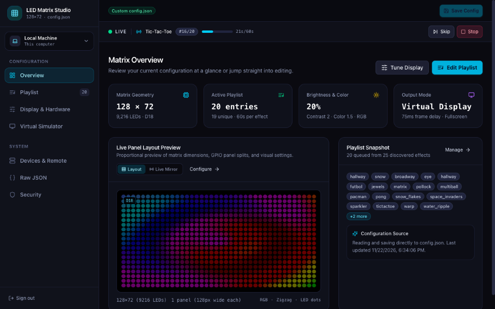

# Raspberry Pi LED Matrix

This is a LED matrix library that simplifies driving a LED matrix of any size created with WS2812B and WS2811 LED strips.  It also is a virtual LED matrix simulator you can use to help create effects, and animations without the need for a physical matrix.  When running effects you can execute them individually, or in a random playlist.

### Virtual Environment Simulator 60x30 Example

<https://user-images.githubusercontent.com/1588877/177685586-e4cb158d-c840-4b89-855e-5bfd087991b5.mp4>

### Physical LED Matrix 60x30 Example

<https://user-images.githubusercontent.com/1588877/177685583-cab5ac70-1f26-48f9-ab31-55bf0a61bf8d.mp4>

## LED Matrix Studio (Web UI & Remote Control)

You don't need to hand-edit `config.json`, run `ffmpeg` resize commands by hand, or SSH into your Raspberry Pi every time you want to tweak your display. **LED Matrix Studio** gives you a modern web interface that makes running and customizing your matrix effortless:



- **Visual config & live playback**: Build and reorder playlists, tune brightness/color/pins, click **Play Now** or **Skip** in real time, and hot-reload `config.json` changes without restarting.
- **Drop-in image & video uploads**: Upload photos or clips right from your browser — Studio smart-crops, trims, and transcodes them to match your exact LED matrix dimensions automatically.
- **Control a Raspberry Pi from another room**: Run Studio on your laptop and connect to one or more headless Raspberry Pis over your local network, watch a **Live Matrix Mirror** of what's playing, and pull new updates with one-click **Pull & Restart**.
- **Zero extra Python dependencies on the Pi**: The Studio backend uses only Python 3's standard library.

```bash
make web-build   # build the React UI once (only needed on the machine serving the UI)
make web         # open http://localhost:8080
```

See [web/README.md](web/README.md) for full Studio documentation and screenshots, and [deploy/systemd/README.md](deploy/systemd/README.md) to auto-start the server headlessly on Raspberry Pi boot.

## Virtual Environment Quick Start

```bash
git clone git@github.com:natelewis/pi-led-matrix.git
cd pi-led-matrix
make bootstrap
make run effect=rgb_test
# Red, green, blue... in a 600x300 window
# ctl-c (or q / Esc) to stop script
```

To run the virtual display on a Raspberry Pi monitor or TV (even when the adafruit packages are installed), set `"virtual": true` in `config.json` (or run with `VIRTUAL_MATRIX=1`).

Virtual display options in `config.json`:
* `virtual` - force virtual monitor mode (`false` by default; auto-enabled when adafruit libs are not installed)
* `virtual_fullscreen` - open fullscreen and hide the cursor (`false` by default)
* `virtual_led_dots` - render pixels as round LED dots instead of solid squares (`true` by default)

Controls while running in virtual mode: `f` toggles fullscreen, `d` toggles LED dots, `Space` / `Right` / `n` skips to the next playlist effect, and `q` / `Esc` quits.

## LED Matrix Hardware

High level construction details of a LED matrix panel.

Shopping List:

* WS281x LED strips
* 5V power supply
* Raspberry Pi 4
* A few extra meters of 3 pin wire @ 22AWG
* Male/Female JST SM 3 Pin Connectors to create an extension cable from where your panel is to your Pi/PSU
* Curtain rod or other hangable rod you can attach your strips to
* Hobby wood/bamboo @ 3/8" wide to stick on the back of the LED strips to keep them straight
* A bit of patience -- Takes about 4-5 hours to put it all together

In this example I built a 60x30 array with 5V 300W 60A power supply, which is plenty of power for this size matrix.

1. Collect a 60 count of 30 LED per meter 1M strips
2. Build the matrix in a chain pattern:

    ```text
    _   _   _   _ ...
    | | | | | |
    | | | | | |
    | | | | | |
    | | | | | |
    | | | | | |
    |_| |_| |_|
    ```

3. Attach 5V power from the PSU to top of each strip in parallel ( every other one )

4. Connect GPIO 18 (pin 12) of the RPi4 to the green LED wire

5. Connect GND pin of the RPi4 to COM of the power supply

6. Hang the LED strips to the curtain rod or other mount with your adhesive of choice

## Raspberry Pi setup

1. Install RPi OS 32 bit

2. Get your Pi on your network, running headless and pull down this repo

3. Execute the following to globally install libraries and dependencies:

    ```bash
    sudo apt update
    sudo apt install -y pkg-config
    sudo apt install -y ffmpeg libopenblas-dev libavformat-dev libavcodec-dev libswscale-dev

    git clone https://github.com/natelewis/pi-led-matrix.git
    cd pi-led-matrix
    make bootstrap
    cp default_config.json config.json
    ```

4. Update the `config.json` to adjust sizes or values if anything is different.

## Testing your LED matrix

Running the test script will cycle between R..., G..., B... (repeat)...
Depending on what version of the strips you have, it might be possible the RGB colors are swapped around.   You can fix this by changing the `color_order` value in your config file.

```bash
make run effect=rgb_test
# ctl-c to stop script
```

## Turning of your LEDs

LEDs will maintain their currently lit state when you cancel your script.  You can use the off effect to turn them off:

```bash
make off
# alias to: make run effect=off
```

## Effects

Custom effects are organized in the `effects` directory with the following structure:

```bash
> src > effects > effect_name > effects.py
```

They can be displayed with:

```bash
make run effect=effect_name
```

Some that support options can be passed a config:

```bash
make run effect=effect_name config='{"some_json": "config settings"}'
```

[View the effects list and usage details](effects/README.md)

## Playlist

Run a slide show of effects that run in random order with a delay between effects.   When ever running
a single effect, the playlist json will be display on execution, use this to build your custom playlist.

```bash
make playlist
```

You can choose what effects are in the playlist and the delay in the `config.py`.

# API

When emulating the LED array locally, it detects you do not have any of the adafruit modules installed (or has `"virtual": true` in `config.json`) and fails over to virtual mode.  To synchronously pause your event loop when animating use the `matrix.delay()` function.  This will ensure your rendering window stays open while waiting.

If you want use this outside of the effects directory import the `Matrix` class.  If you are building inside an [effect](effects/README.md) this is already been done for you and passed to your `run()` function.

```python
# import matrix if not in an effect run()
import sys

sys.path.append("./src")
from main import Matrix

matrix = Matrix()

# draw some random things to show how this works
matrix.reset()  # black background (0, 0, 0)
matrix.line((0, 0), (60, 30), (255, 0, 0), 1)  # diagonal red line
matrix.rectangle((5, 5), (55, 25), (0, 255, 0), 1)  # green rectangle
matrix.circle((30, 15), 10, (0, 0, 255), 2)  # blue circle
matrix.show()
matrix.delay(10000)  # delay 10 seconds before shutting virtual window down
```

```
./.venv/python test.py
```


A simple effect:

```python
def run(matrix, _):
    """flash rapidly between red and blue"""
    while matrix.ready():
        matrix.reset(matrix.color("red"))
        matrix.show()
        matrix.reset(matrix.color("blue"))
        matrix.show()
```

<br/>

`matrix.circle((x,y), radius, (r, g, b), width)`

---

Draw a circle from its center point with a given radius.  A width of `-1` will fill in the circle.

```python
matrix.circle((30, 15), 10, (0, 0, 255),  3) # blue circle
matrix.show()
matrix.delay(5000)
```

<br/>

`matrix.color(css_color_name)`

---

Return the color for any standard [css color name](https://www.w3.org/wiki/CSS/Properties/color/keywords).

```python
matrix.reset(matrix.color('fuchsia')) # paint led's fuchsia (255, 0, 255)
matrix.show()
matrix.delay(5000)
```

<br/>

`matrix.delay(ms)`

---

Sleep x amount of milliseconds.

```python
matrix.delay(1000) # 1 second
matrix.delay(1000 * 60) # 1 minute
```

<br/>

`matrix.frame`

---

Access to the numpy array that contains the matrix values.  This can be manipulated, or tested against.

```python
import numpy as np

def is_it_off:
    # check if all values are 0's
    return np.all(matrix.frame==0)
```

<br/>

`matrix.image(Image)`

---

Display an image using the Python Imaging Library (PIL).

```python
from PIL import Image
image = Image.open(image_file)
matrix.image(image)
matrix.show()
matrix.delay(5000)
```

<br/>

`matrix.line((x,y), (x,y), (r, g, b), width)`

---

Draw a line from the start to the end coordinates.

```python
matrix.line((0, 0), (60, 30), (255, 0, 0),  1) # diagonal red line
matrix.show()
matrix.delay(5000)
```

<br/>

`matrix.pixel((x,y), (r, g, b))`

---

Draw a line from the start to the end coordinates.

```python
matrix.line((30, 15), (255, 0, 0),  1) # diagonal red line
matrix.show()
matrix.delay(5000)
```

<br/>

`matrix.polyfill(points, (r, g, b))`

---

Draw one or more filled polygons. `points` is a list of NumPy `int32` arrays of `(x, y)` vertex coordinates.

```python
import numpy as np

triangle = np.array([(30, 2), (10, 27), (50, 27)], dtype=np.int32)
matrix.polyfill([triangle], (0, 255, 0)) # filled green triangle
matrix.show()
matrix.delay(5000)
```

<br/>

`matrix.polylines(points, (r, g, b), width)`

---

Draw the closed outline of one or more polygons with the given line width. `points` is a list of NumPy `int32` arrays of `(x, y)` vertex coordinates.

```python
import numpy as np

triangle = np.array([(30, 2), (10, 27), (50, 27)], dtype=np.int32)
matrix.polylines([triangle], (255, 0, 0), 1) # red triangle outline
matrix.show()
matrix.delay(5000)
```

<br/>

`matrix.random_color()`

---

Return a random color

```python
matrix.line((0, 0), (60, 30), matrix.random_color(),  1) # random colored line
matrix.show()
matrix.delay(5000)
```

<br/>
`matrix.rectangle((x,y), (x,y), (r, g, b), width)`

---

Draw a rectangle from the start to the end coordinates.

```python
matrix.rectangle((5, 5), (55, 25), (255, 0, 0),  1) # red rectangle
matrix.show()
matrix.delay(5000)
```

<br/>

`matrix.reset((r, g, b))`

---

Reset all the pixels on the matrix to the RGB value given.  If no value is given it will default to all black (0, 0, 0).

```python
matrix.reset((255, 0 , 0)) # all LEDs red
matrix.show()
matrix.delay(5000)
matrix.reset() # turn off all LEDs -- same as matrix.reset((0, 0, 0))
matrix.show()
```

<br/>

`matrix.show()`

---

Paint the current image to the LEDs

```python
matrix.reset((0, 0, 255))
matrix.show() # turn all LEDs blue
matrix.delay(1000)
matrix.reset()
matrix.show() # turn off all LEDs

```

<br/>

`matrix.sprite(sprite_map, start, color_map)`

---

Draw a custom sprite of any size on the matrix, where the upper left corner is the starting coordinates.

```python
# smiley face with a blue nose, green eyes and red smile in the upper hand corner of the matrix
matrix.sprite(
    ([  [' ', ' ', ' ', ' ', ' '],

        ['1', '1', ' ', '1', '1'],

        ['1', '1', ' ', '1', '1'],

        [' ', ' ', ' ', ' ', ' '],

        [' ', ' ', 'o', ' ', ' '],

        [' ', ' ', 'o', ' ', ' '],

        ['x', ' ', ' ', ' ', 'x'],

        [' ', 'x', 'x', 'x', ' '],

        [' ', ' ', ' ', ' ', ' ']]),
    (0, 0),
    {
        '1': (0, 255, 0), # 1's are green
        'x': (255, 0, 0), # x's are read
        'o': (0, 0, 255), # o's are blue
    })
matrix.show()
matrix.delay(10000)

```

<br/>

`matrix.text(self, text, start, font_size, color, ttf_font_file)`

---

Place the upper left point of the text at a given location. Custom font files should be placed in the `./fonts/` directory, and can be any ttf file.  The default font is used if none is passed.

```python
matrix.text('hello', (10,20), 16, (255,0,0))
matrix.show()
matrix.delay(5000)
matrix.text('hello', (10,20), 16, (255,0,0), 'custom.ttf')
matrix.show()
matrix.delay(5000)
```

<br/>

## Contributing

Checkout [CONTRIBUTING.md](CONTRIBUTING.md)

---

Created by [@natelewis](https://github.com/natelewis). Released under the MIT license.
