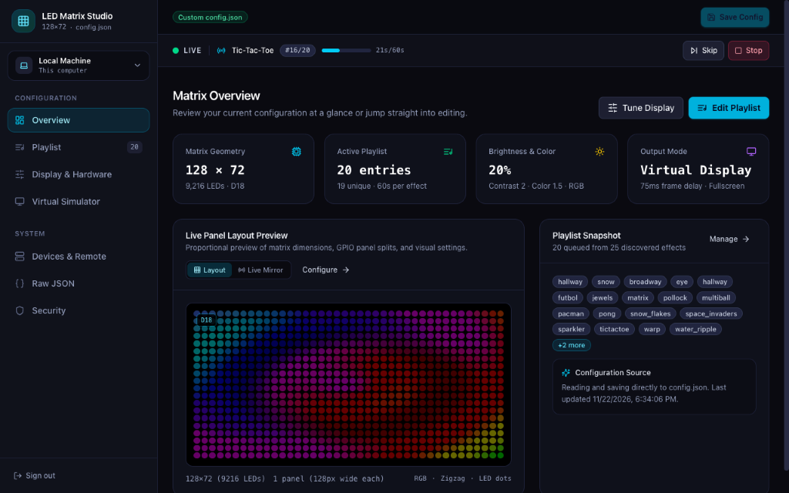
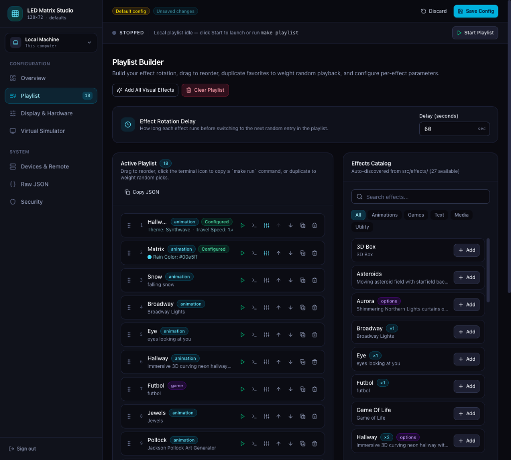
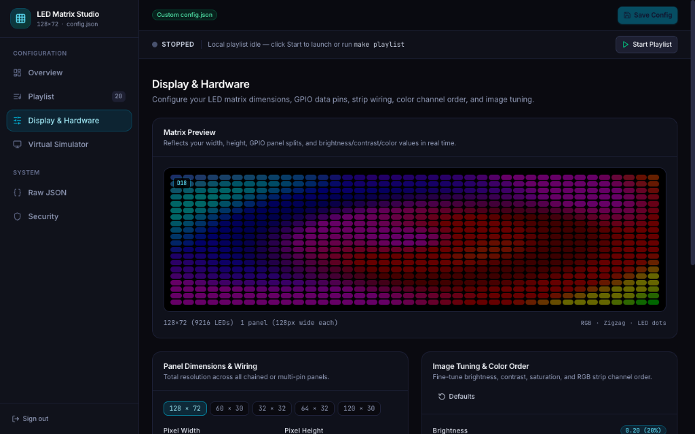
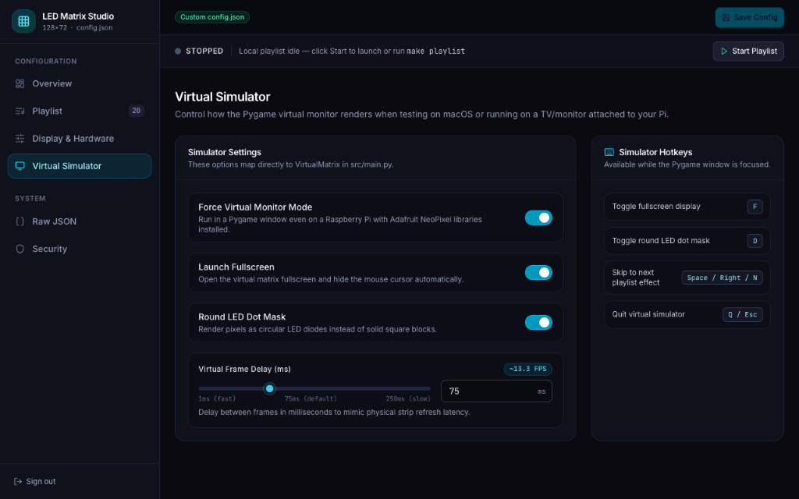
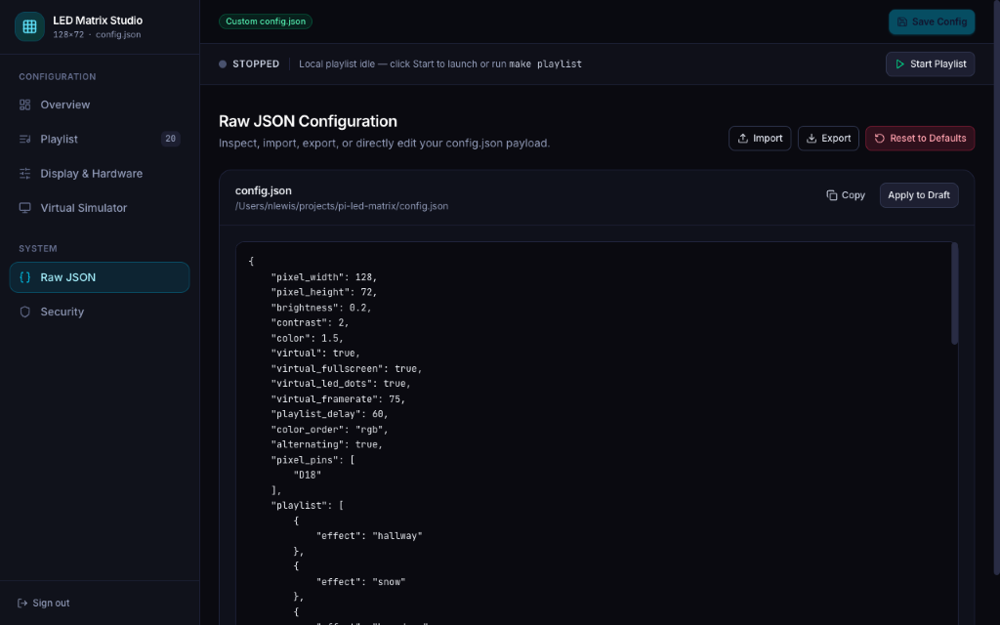
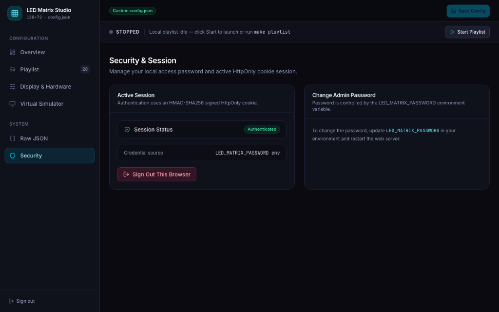
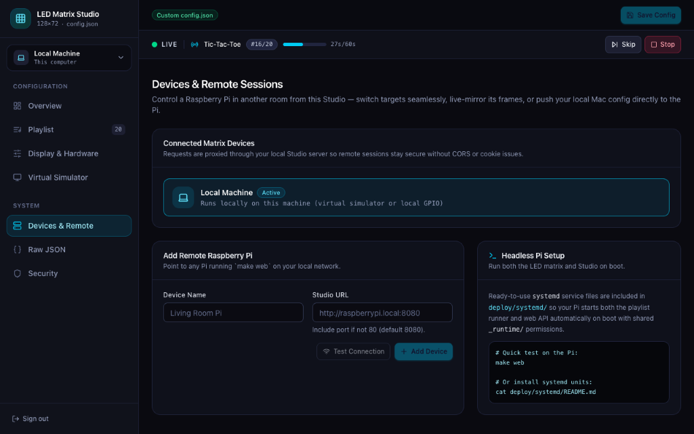

# LED Matrix Studio (Web Configurator & Live Controller)

A self-contained local web server and React frontend for configuring and controlling your `pi-led-matrix` remotely over your local network.

## Features

- **Remote Sessions & Multi-Device Studio**: Connect your local Mac Studio to one or more remote Raspberry Pis over LAN via a built-in authenticated reverse proxy (zero CORS/cookie issues), switch devices from the sidebar, watch a **Live Matrix Mirror** (~6–7 FPS pixel stream) of what's playing in the other room, and detect & apply remote software updates with one-click **Pull & Restart**.
- **Live Playback Control**: Start/stop the playlist runner, skip effects in real time, jump directly to any playlist item with **Play Now**, and hot-reload `config.json` edits into a running playlist without restarting.
- **Playlist Builder**: Drag-and-drop or button-based ordering, effect duplication (to weight random playback), searchable auto-discovered catalog from `src/effects/`, one-click terminal `make run ...` command copying, and per-effect editors (`marquee`, `image`, `video`, or custom JSON).
- **Smart Image & Video Uploaders**: Upload images or videos directly to gitignored `_uploads/` folders (`src/effects/image/_uploads/` and `src/effects/video/_uploads/`), automatically sized to your matrix `pixel_width × pixel_height` with saliency-guided smart cropping, drag-to-adjust framing, zoom, optional video trim, and live LED dot previews.
- **Display & Hardware Config**: Live proportional LED layout preview, resolution presets (`128 × 72` default), GPIO pin multi-selector (`D10`, `D12`, `D18`, `D21`) with panel-split validation, alternating zigzag wiring toggle, RGB channel order selector, and brightness/contrast/color sliders.
- **Virtual Simulator Settings**: Toggle virtual monitor mode, fullscreen, round LED dots, and frame delay (`virtual_framerate`).
- **Raw JSON Inspector**: Direct edit, copy, import/export `config.json`, and safe reset to `default_config.json`.
- **Simple Local Auth**: First-run password setup (or `LED_MATRIX_PASSWORD` env var), salted PBKDF2-SHA256 hashing, and HMAC-SHA256 signed `HttpOnly` session cookies.
- **Pi-Friendly Zero-Dep Server**: The Python backend uses only Python 3's standard library — no extra pip packages or native builds required on a Raspberry Pi.

## Screenshots

| Overview | Playlist Builder |
| --- | --- |
|  |  |

| Display & Hardware | Virtual Simulator |
| --- | --- |
|  |  |

| Raw JSON | Security |
| --- | --- |
|  |  |

| Devices & Remote Sessions |
| --- |
|  |

## Quick Start

### 1. Build the React frontend

```bash
make web-build
```

### 2. Run the web server

```bash
make web
```

Then open `http://localhost:8080` (or `http://<raspberry-pi-ip>:8080` on your LAN). On your first visit you will be prompted to create a local admin password.

### Development Mode (Vite HMR + Backend Auto-Reload)

```bash
make web-dev
```

- React dev server: `http://localhost:5188` (proxies `/api/*` to `:8080`)
- Python API server: `http://127.0.0.1:8080` (auto-reloads on `web/server/*.py` edits)

### Run Backend Tests

```bash
make web-test
```

## Environment Variables

| Variable | Default | Description |
| --- | --- | --- |
| `LED_MATRIX_WEB_HOST` | `0.0.0.0` | Bind address for the web server |
| `LED_MATRIX_WEB_PORT` | `8080` | Port for the web server |
| `LED_MATRIX_DEV_PORT` | `5188` | Port for the Vite dev server (`make web-dev`) |
| `LED_MATRIX_PASSWORD` | *(unset)* | Optional fixed admin password (overrides `web/.auth.json`) |

## Architecture & Extending

```text
web/
├── docs/screenshots/     # UI screenshots for docs & PRs
├── server/
│   ├── app.py            # HTTP server, API routes, Range streaming, static SPA serving, --reload
│   ├── auth.py           # PBKDF2 password auth & signed HttpOnly cookies
│   ├── config_store.py   # Schema validation & atomic writes to config.json
│   ├── effects.py        # AST-based discovery of src/effects/*, fonts/*, and _uploads/*
│   ├── git_ops.py        # Safe non-interactive git status & --ff-only pull helpers
│   ├── media.py          # RGBA PNG encoder & ffmpeg video transcoder for _uploads/
│   ├── playback.py       # Local playlist process manager, _runtime IPC & live frame mirror
│   ├── router.py         # Lightweight Express-style route registry
│   ├── targets.py        # Remote Pi registry & authenticated streaming HTTP reverse proxy
│   └── tests/            # Unit & integration tests
└── client/
    └── src/
        ├── api/          # Typed fetch client
        ├── hooks/        # useAuth, useMatrixConfig, usePlayback
        ├── utils/        # smartCrop saliency engine, CLI command builder, playlist labels
        ├── components/
        │   ├── ui/       # Reusable UI primitives (Button, Card, Field, Modal, Slider, Switch, Toast...)
        │   ├── layout/   # AppShell + declarative navItems.ts registry
        │   └── config/   # MatrixPreviewGrid, LivePlaybackBar, PlaylistItemRow, Image/VideoUploadCropper, EffectConfigModal
        └── pages/        # Feature pages
```

### Adding Future Features

1. **Effect Options (`CONFIG_SCHEMA`)**: Declare a top-level `CONFIG_SCHEMA` list inside any `src/effects/<name>/effect.py` using `select`, `number`, `boolean`, `color`, or `text` fields — `web/server/effects.py` discovers it automatically and renders dropdowns, sliders, toggles, or the standard color picker in `EffectConfigModal` (see [src/effects/README.md](../src/effects/README.md#declaring-ui-controls-config_schema)).
2. **Backend**: Register new endpoints on `router` inside `web/server/app.py`. All routes default to `require_auth=True`.
3. **Frontend**: Add an entry to `NAV_ITEMS` in `web/client/src/components/layout/navItems.ts`, create a page component reusing primitives from `@/components/ui`, and render it in `App.tsx`.
